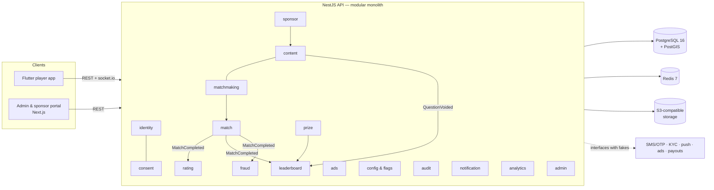

# Architecture (one page)

The full rules are in `CLAUDE.md`; this page summarises them and shows how the pieces fit.

## Shape

A **modular monolith**: one NestJS API (`apps/api`) with a module per business area, a Next.js admin and sponsor
portal (`apps/admin`), and a Flutter player app (`apps/mobile`). Shared TypeScript types, zod schemas and error codes
live in `packages/shared`. PostgreSQL 16 with PostGIS holds the records; Redis 7 holds queues, sessions, leaderboards,
rate limits and jobs; S3-compatible storage holds files.

## Rules in brief

1. **The server decides**: timing, answers, scores, ratings, eligibility and prizes. Client scores and times are
   never trusted.
2. **Ledgers are append-only**: scores, points and prizes. Corrections are new entries with reason, actor and approver.
3. **Idempotent money and points writes**, inside transactions.
4. **Business defaults are configuration**, audited, never code constants.
5. **`prizes.enabled` is false everywhere**; no campaign activates without a legal approval record.
6. **No wallet, stored value, purchasable points or paid entry.** Points have no cash value.
7. **Personal data stays in the Saudi region.** Location exists only on an open queue ticket, rounded to about 1 km,
   and is deleted when the match starts; opponents see a city and a distance band.
8. **Sponsors see aggregates only.**
9. **Modules talk through services or domain events**, never another module's tables.
10. **External providers sit behind interfaces** with fakes for local and test.

## Code layout

| Path                    | What                                                                                                      |
| ----------------------- | --------------------------------------------------------------------------------------------------------- |
| `apps/api/src/core/`    | Environment validation, logging with request ids, error filter, i18n, connections, `/health`              |
| `apps/api/src/modules/` | One folder per module, each with a README of its job and BRD IDs                                          |
| `apps/api/test/`        | Integration tests against real PostgreSQL, Redis and storage; `db.ts` makes a throwaway database per file |
| `apps/admin/`           | Next.js App Router, Tailwind, RTL by default (`lang` cookie switches to English)                          |
| `apps/mobile/`          | Flutter, Arabic default with RTL; strings in `lib/l10n/*.arb`                                             |
| `packages/shared/`      | Product name, error codes, health schema, locales                                                         |

## Cross-cutting behaviour

- **Errors:** every failure returns `{ error: { code, message, requestId, details? } }`; `code` comes from
  `packages/shared`, `message` is in the caller's language (`?lang=` or `Accept-Language`, Arabic by default). Stack
  traces and internal messages are logged, never returned.
- **Logs:** JSON (pino) with a request id per request (`x-request-id`, reused when well-formed); authorization
  headers, cookies and bodies are never logged.
- **Health:** `GET /health` checks the database, Redis and the storage bucket, each with a 2-second limit; 200 when all
  are up, 503 with the failing check named otherwise.
- **API docs:** OpenAPI at `/docs` (JSON at `/docs/openapi.json`).

## Local object storage

MinIO no longer publishes community images, so `docker-compose.yml` runs RustFS, an S3-compatible store, in its
place. The API uses only the S3 API, so any S3-compatible service (including the Saudi cloud provider's) can replace it.
